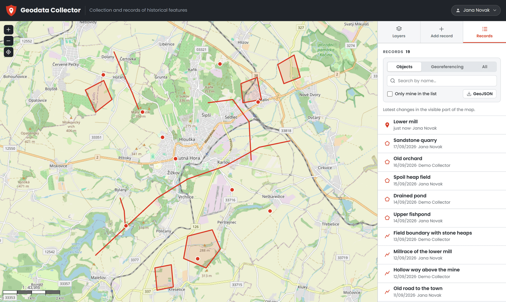
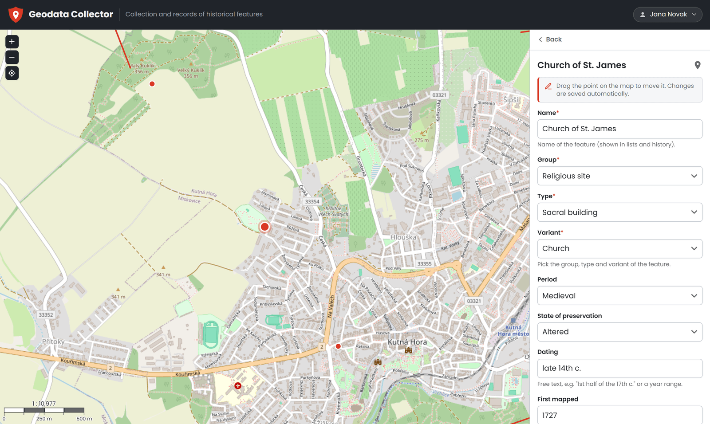
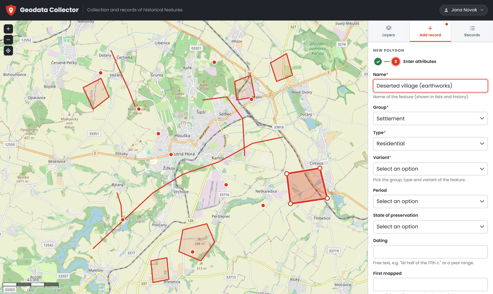
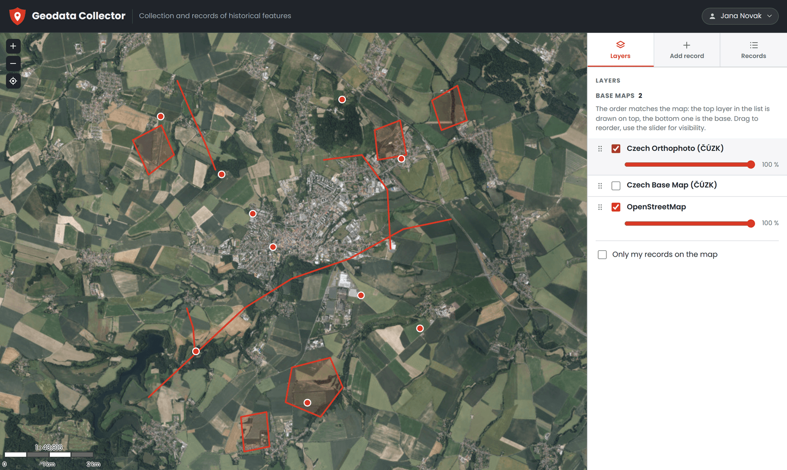
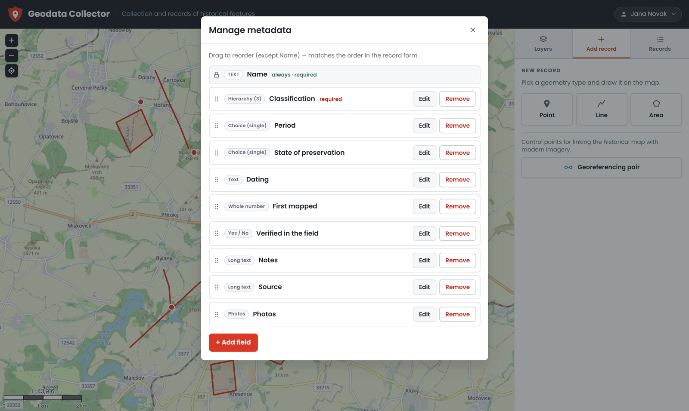
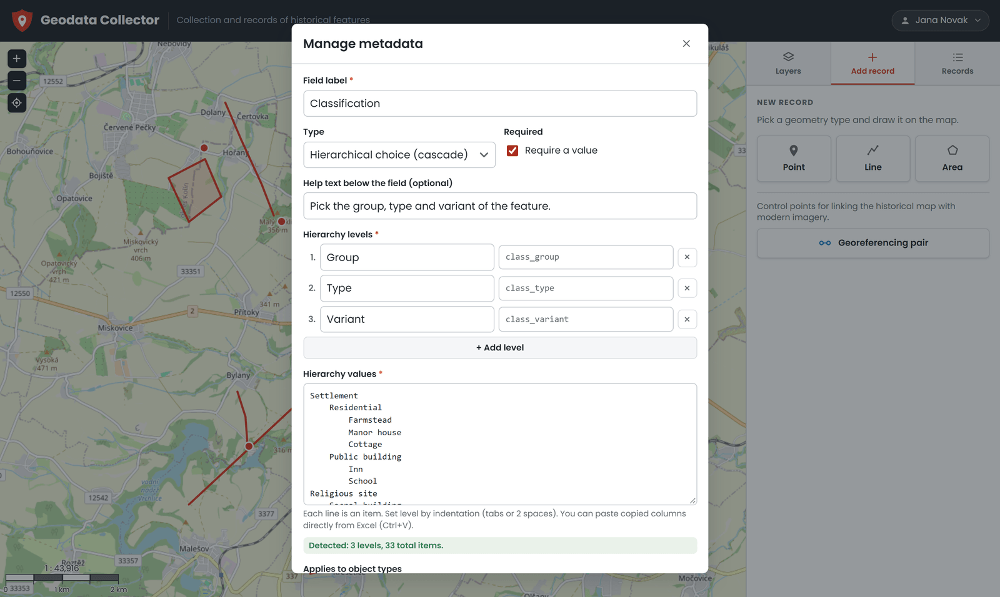
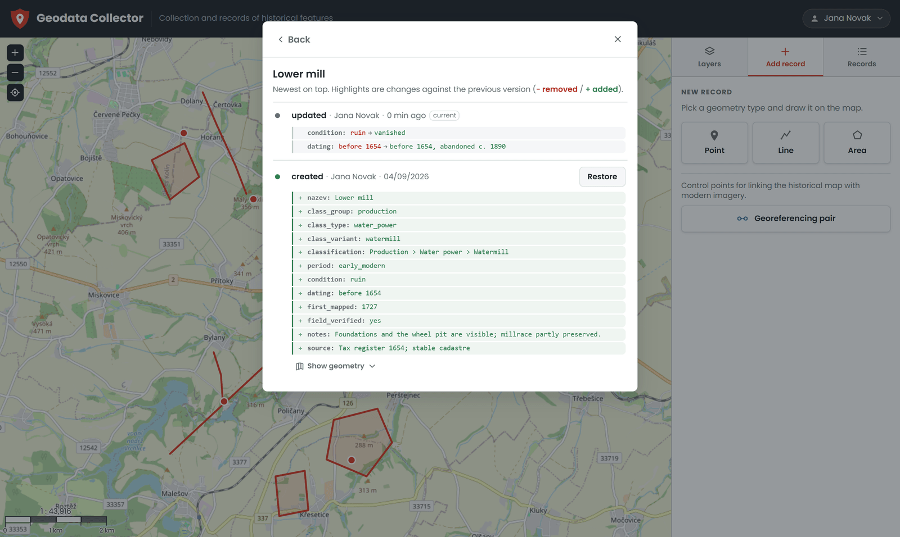
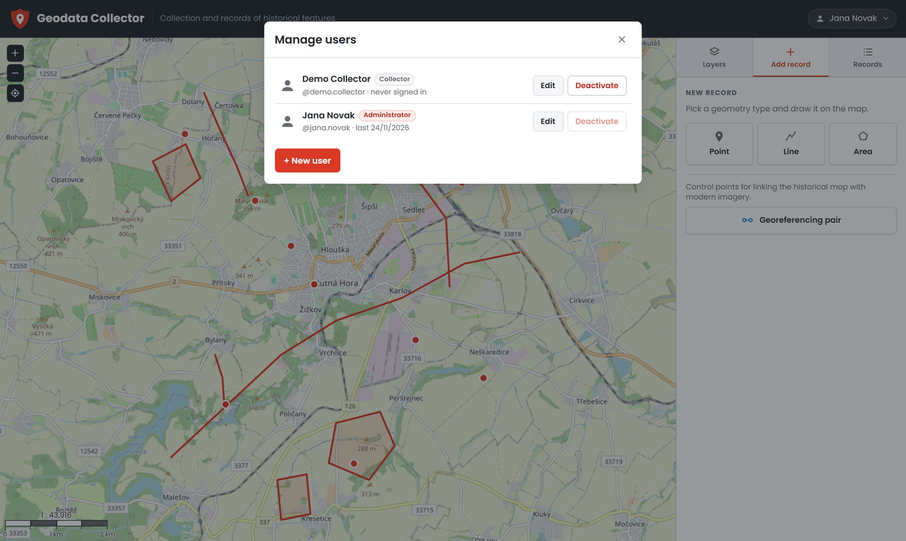
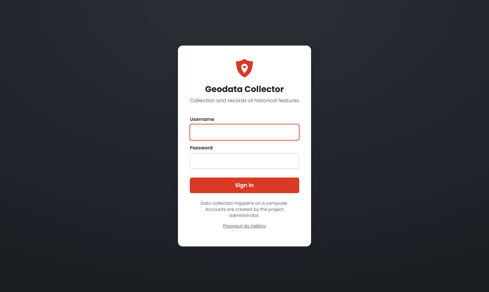

<p align="center">
  
</p>

<h1 align="center">Geodata Collector</h1>

<p align="center">
  Self-hosted web app for collecting points, lines and areas on a map,<br>
  described with your own attribute schema.
</p>

<p align="center">
  <a href="https://github.com/misavojte/GeodataCollector/actions/workflows/ci.yml"></a>
  <a href="LICENSE"></a>
  
  
  
</p>



Built for historians and landscape archaeologists, usable by any team that collects
geometries with structured descriptions. Admins define the fields in the browser,
collectors draw and describe features, every change is versioned.

Runs on **shared PHP hosting** (no Node.js, Docker or GIS server in production), stores data
in **MySQL/MariaDB** and exports **GeoJSON** for QGIS, R or Python.

## Contents

- [Features](#features)
- [Screenshots](#screenshots)
- [Quick start](#quick-start)
- [Deployment](#deployment)
- [Configuration](#configuration)
- [Your data](#your-data)
- [Project structure](#project-structure)
- [Contributing](#contributing) · [Authors](#authors) · [Citation](#citation) · [License](#license)

## Features

**Collectors**
- Draw points, lines and polygons. Drag vertices, drag an edge to add one, right-click to delete.
- Forms generated from your schema: text, numbers, dates, yes/no, single/multiple choice,
  **cascading choices** (e.g. Group → Type → Variant), **photos and documents** (HEIC supported, EXIF date and GPS kept).
- Autosave, searchable record list, "only mine" filter.
- Base maps and overlays with opacity and drag-to-reorder. OpenStreetMap by default; add any
  public **WMS, WMTS or XYZ** service, also in other coordinate systems. **Private WMS** goes through a server proxy.
- **Georeferencing pairs**: ground control points linking a historical map to modern imagery.
- English and Czech UI, switchable per user.

**Administrators**
- **Metadata editor**: add, reorder and edit fields without code or schema changes.
- **Change history**: every version with a diff; restore any record, including deleted ones.
- **Users** with two roles, administrator and collector.
- **GeoJSON export** with all attributes, author and creation date.
- CSRF protection, login rate limiting, protected config and data folders, audit log.

Drawing is desktop-only; touch-only devices are blocked.

## Screenshots

| | |
|---|---|
|  **Record detail.** Form generated from your fields, saved automatically. |  **New record.** Draw, then describe. |
|  **Layers.** Stack base maps, set opacity. |  **Manage metadata.** Your schema, edited in the browser. |
|  **Cascading fields.** Paste an indented list, e.g. from Excel. |  **Change history.** Diff per version, one-click restore. |
|  **Users.** Administrators and collectors. |  **Sign-in** with your project name. |

Screenshots use the optional demo dataset (a fictional survey near Kutná Hora, Czechia).

## Quick start

Requirements: **PHP 8.0+** (`pdo_mysql`, `mbstring`, `curl`; `imagick` or `gd` for photos),
**MySQL 8 / MariaDB 10.2.7+**, **Node.js 18+** (frontend build only).

```bash
git clone https://github.com/misavojte/GeodataCollector.git
cd GeodataCollector

# 1) Create a database and user, e.g.:
#    CREATE DATABASE geodata CHARACTER SET utf8mb4 COLLATE utf8mb4_unicode_ci;
#    CREATE USER 'geodata'@'localhost' IDENTIFIED BY 'change-me';
#    GRANT ALL ON geodata.* TO 'geodata'@'localhost';

# 2) Configure the connection (on plain http://localhost also set 'cookie_secure' => false)
cp config/config.example.php config/config.php

# 3) Tables, defaults and your admin account
php tools/install.php
php tools/install.php --demo       # optional sample fields and 19 features

# 4) Build the frontend and run
(cd frontend && npm install && npm run build)
php -S 127.0.0.1:8088 router.php
```

Open <http://127.0.0.1:8088>, sign in and design your fields under **Manage metadata**
(account menu). A new install has one protected field, **Name**.

<details>
<summary>Frontend development with hot reload</summary>

```bash
php -S 127.0.0.1:8088 router.php          # terminal A: PHP API
cd frontend && npm run dev                 # terminal B: Vite, proxies /api to :8088
```
</details>

## Deployment

Works on shared hosting with Apache (`mod_rewrite`, `mod_headers`). No shell needed.

1. **Package**: download a zip from [Releases](https://github.com/misavojte/GeodataCollector/releases),
   or build one with `node tools/build-deploy.mjs` (domain root) or `node tools/build-deploy.mjs geodata` (subdirectory).
2. **Upload** its contents via FTP.
3. **Database**: import `db/schema.sql` and `db/seed.sql` in phpMyAdmin, or run `php tools/install.php` over SSH.
4. **Config**: copy `config/config.example.php` to `config/config.php` and fill in the database.
5. **First account**: use the token-protected `tools/create_admin.php`, then disable it.

Full guide with updates and troubleshooting: **[DEPLOY.md](DEPLOY.md)**.

## Configuration

All settings are in `config/config.php` (not in git):

| Key | Purpose |
|-----|---------|
| `app.name`, `app.subtitle` | Project name in the header and on the sign-in page. |
| `app.default_language` | `'en'` or `'cs'` until a user picks a language. |
| `db.*` | Database connection. |
| `map.default_center`, `map.default_zoom`, `map.max_bounds` | Initial view and allowed extent. Set to your study area. |
| `security.*` | HTTPS-only cookies, login attempt limits. |
| `setup.*` | Temporarily enables `tools/create_admin.php`. |

Map layers are managed in the app (**Manage layers**). Password-protected WMS goes into
`config/layers.php` and is proxied by the server. Custom logo: replace `logo.svg` and `frontend/static/logo.svg`.
`GEODATA_CONFIG` can point to a different config file, e.g. for a demo instance.

## Your data

- **Export**: *Records → GeoJSON* gives all records in WGS 84 (lon/lat) with every attribute plus
  `_id`, `_type`, `_author`, `_created`. Opens in QGIS, `sf::st_read()` (R), `geopandas.read_file()` (Python).
- **Database**: native `GEOMETRY` columns and JSON attributes in `features`, queryable directly.
- **Backups**: the database **and** `storage/uploads/` (attachments).
- **Field keys** (e.g. `period`) are stable and used in the export; labels can change any time.

## Project structure

```
.
├── api.php                 REST API front controller (/api/*)
├── login.php, logout.php   Server-rendered sign-in
├── app/                    PHP backend: services, repositories, controllers
├── config/                 config.example.php, layers.php
├── db/                     schema.sql, seed.sql, demo.sql, migrate_*.sql (upgrades)
├── tools/                  install.php (CLI), create_admin.php (web), build-deploy.mjs
├── frontend/               SvelteKit + TypeScript + OpenLayers app
├── docs/                   ARCHITECTURE.md, screenshots
└── router.php              Router for the PHP built-in server (development only)
```

| Layer | Technology |
|-------|------------|
| Frontend | SvelteKit 2, Svelte 5, TypeScript, OpenLayers 10, built to static files |
| Backend | Plain PHP 8, no framework, no Composer dependencies, PDO, JSON REST API |
| Database | MySQL 8 / MariaDB 10.2.7+ with spatial types and JSON |

Data model, request flow and security: **[docs/ARCHITECTURE.md](docs/ARCHITECTURE.md)**.

## Contributing

Issues and pull requests are welcome, see [CONTRIBUTING.md](CONTRIBUTING.md).
Translations especially: add a dictionary next to `frontend/src/lib/i18n.en.ts`
(the `Dict` type lists every key) and register it in `i18n.ts` and `login.php`.

## Authors

- **Karel Macků** ([ORCID](https://orcid.org/0000-0002-5899-2626)), Palacký University Olomouc: concept and initiation
- **Michaela Vojtechovska**: design and development

## Citation

Using it in research? Cite it via GitHub's **"Cite this repository"** button ([`CITATION.cff`](CITATION.cff)).

## License

[MIT](LICENSE) © 2026 Michaela Vojtechovska
